# KingWerx™ CyberScreenSaver

**A free animated screensaver for Windows: fifteen cyber-terminal effects, and a different one on every monitor.**

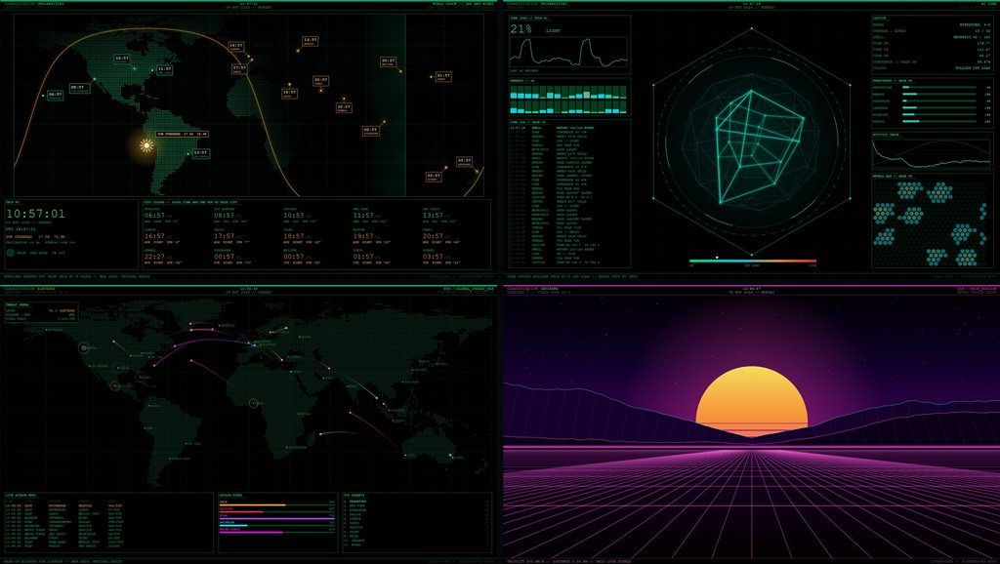

## Download

**[CyberScreenSaver-2.1.0.zip](https://github.com/Antairus/CyberScreenSaver/releases/download/v2.1.0/CyberScreenSaver-2.1.0.zip)** - 4.6 MB, version 2.1.0, signed by KW Tech Solutions LLC

SHA-256: `3D21193FB9CC5C1BA2AEC4BB409CEFF97EFEC900F9458D5D77D041F97CD4BA4C`

The zip holds the signed installer, the full user manual (HTML), README.txt and LICENSE.txt. The same download, and the manual online, are at **[kingwerx.com](https://kingwerx.com/cyberscreensaver.html)**.

Free: no license key and no charge. You may share it, but only as the original, unmodified download. The full terms are in [LICENSE.txt](LICENSE.txt).

## The fifteen effects

Every picture was rendered by version 2.1.0 itself, with made-up test data.

<table>
<tr>
<td width="33%">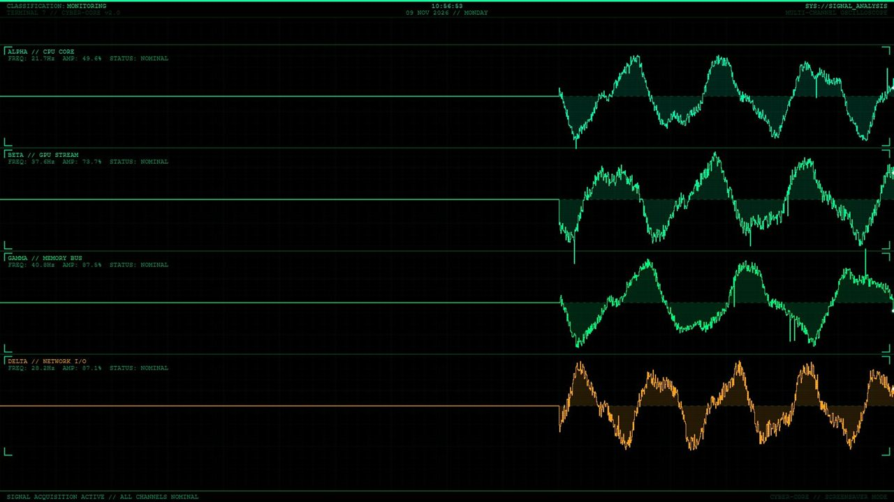 <b>Oscilloscope</b> <i>Just the look</i> Four scrolling signal traces with readouts.</td>
<td width="33%">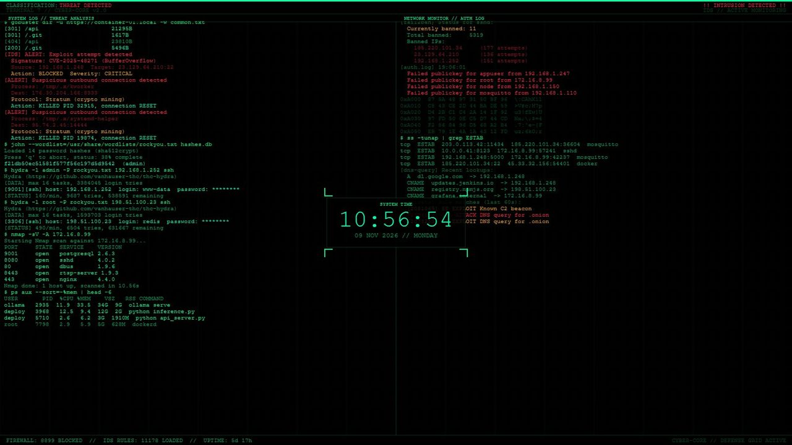 <b>Intrusion terminal</b> <i>Made up for show</i> Two scrolling security logs and a clock. Everything in it is made up; it detects nothing.</td>
<td width="33%">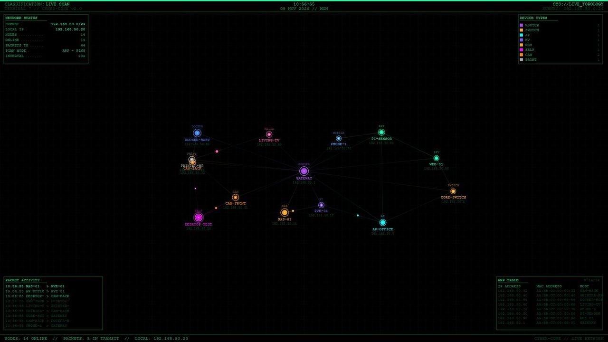 <b>Live network</b> <i>Scans your local network</i> A map of the real devices on your network, drawn around the router.</td>
</tr>
<tr>
<td>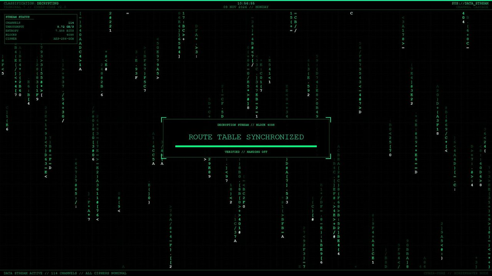 <b>Data rain</b> <i>Just the look</i> Falling columns of characters, with a decoder box that cracks one phrase after another.</td>
<td>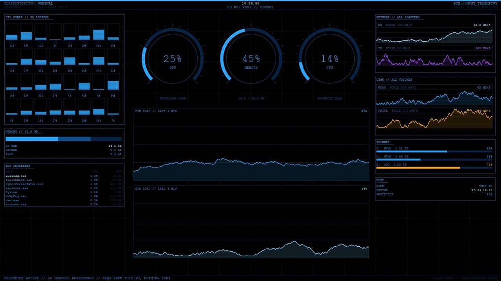 <b>System monitor</b> <i>Reads this PC</i> This PC's processor cores, memory, graphics, disk and network activity, drives and busiest programs, in blue.</td>
<td>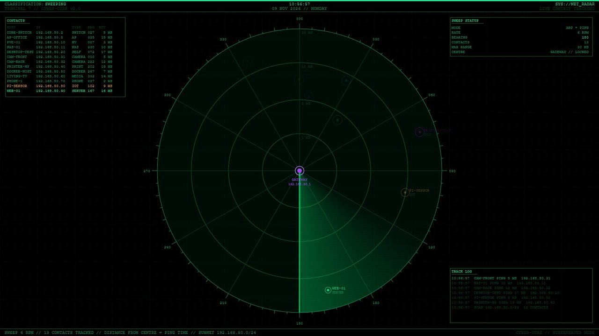 <b>Radar</b> <i>Scans your local network</i> The real devices on your network on a rotating sweep; distance is how long each one takes to answer a ping.</td>
</tr>
<tr>
<td>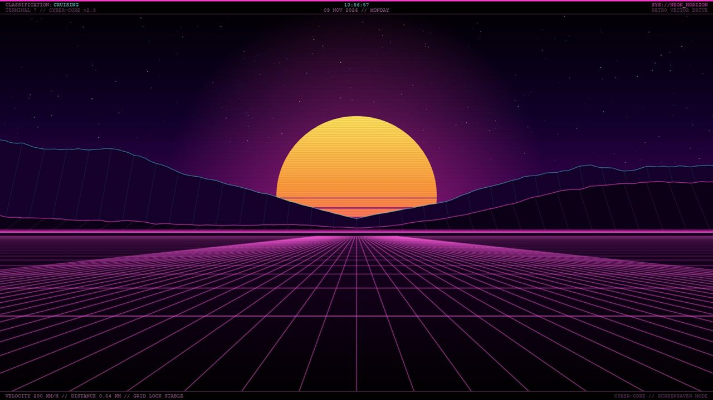 <b>Synthwave grid</b> <i>Just the look</i> A neon grid rolling toward a striped sunset and wireframe mountains.</td>
<td>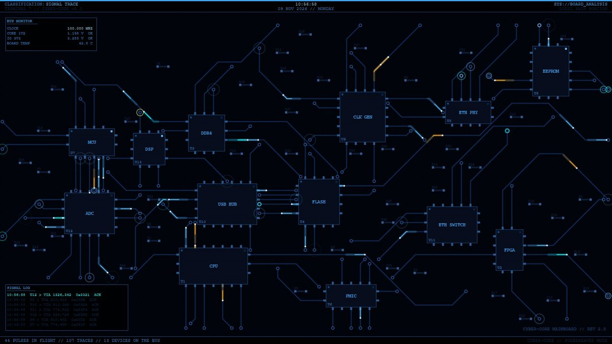 <b>Circuit board</b> <i>Just the look</i> Pulses of light running along circuit traces, in blue. A new board every time.</td>
<td>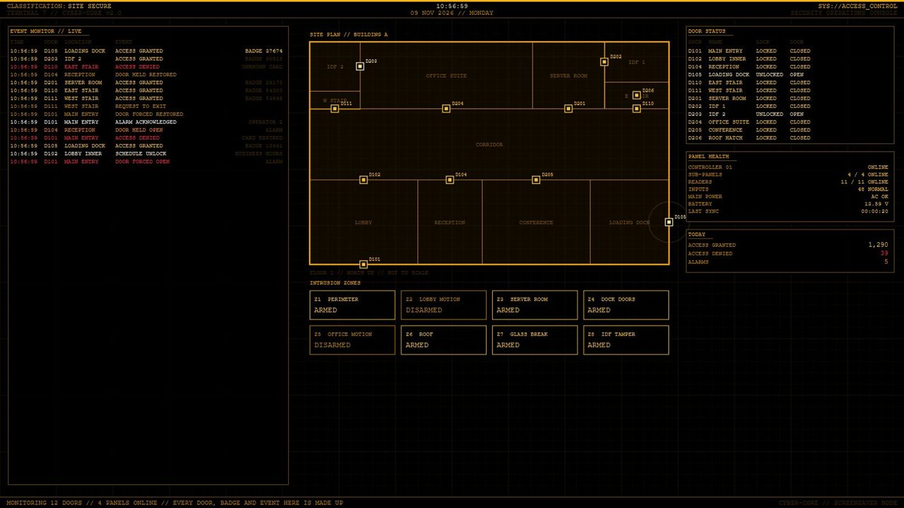 <b>Security console</b> <i>Made up for show</i> A made-up building: doors, readers, alarms and an event log, in amber. It is connected to no system.</td>
</tr>
<tr>
<td>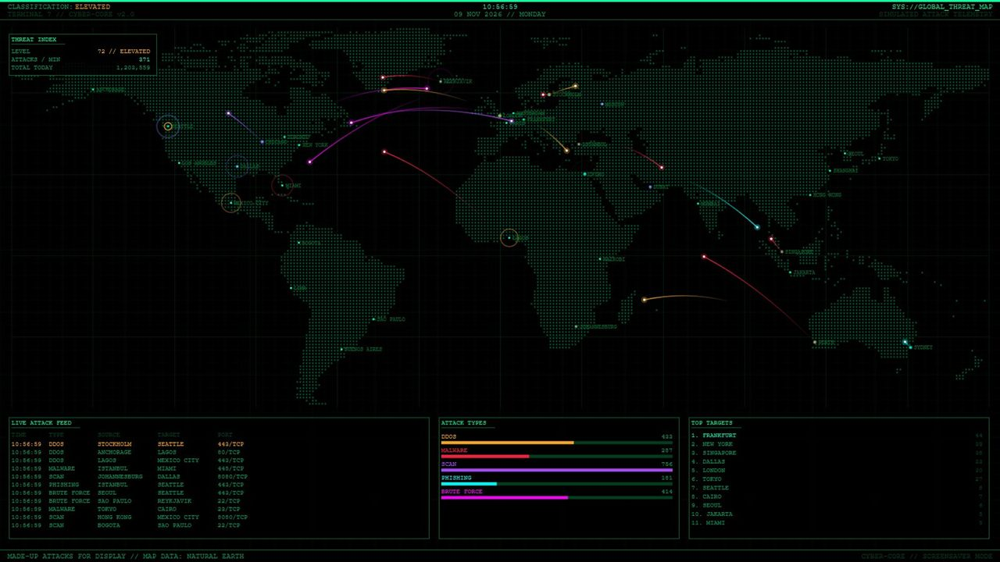 <b>Threat map</b> <i>Made up for show</i> Made-up attacks arcing between cities on a world map.</td>
<td>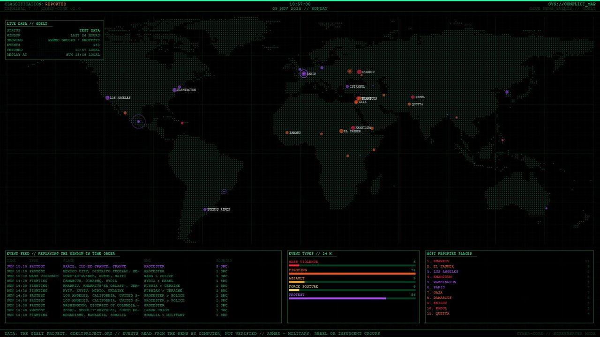 <b>War map</b> <i>Downloads news data</i> Fighting, assaults and protests from the last 24 hours of world news, where they happened. From The GDELT Project; not verified.</td>
<td>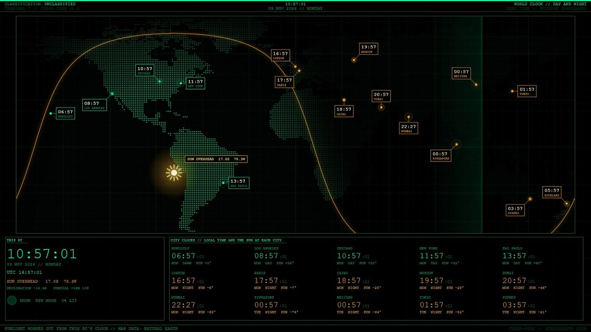 <b>Day/night clock</b> <i>Works from this PC's clock</i> The real sunlit and dark halves of the world, worked out from your PC's clock, with sixteen city clocks and the moon's phase.</td>
</tr>
<tr>
<td>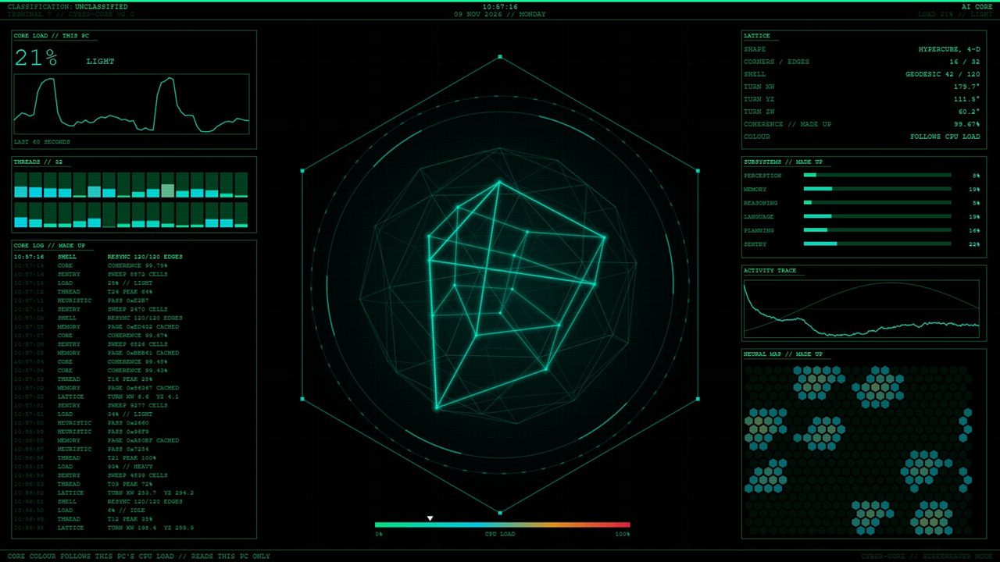 <b>AI core</b> <i>Reads this PC</i> A slowly turning 4-D hypercube whose colour follows your PC's processor load, from green to red.</td>
<td>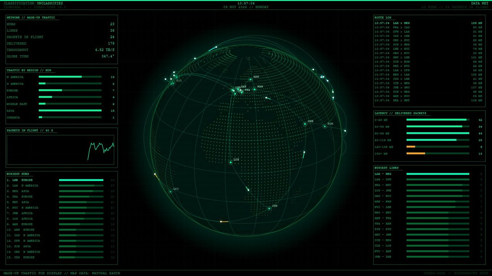 <b>Data net</b> <i>Made up for show</i> A turning globe with made-up network traffic racing between 23 hubs, a route log and traffic charts.</td>
<td>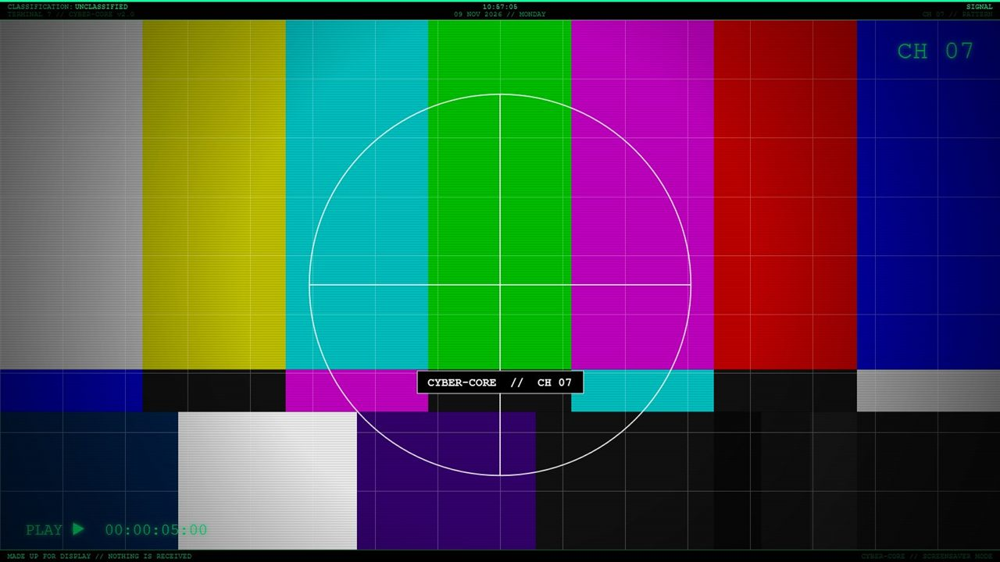 <b>Signal</b> <i>Just the look</i> An old TV channel: a test pattern, tracking trouble, snow with words hidden in it, then a transmission.</td>
</tr>
</table>

## A different effect on every monitor

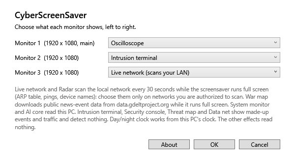

In Screen Saver Settings pick **CyberScreenSaver** and click **Settings**: one drop-down per monitor, numbered left to right. Any number of monitors.

## What it reads, scans and downloads

- **Live network and Radar scan your local network** every 30 seconds while they run full screen: they read this PC's ARP table, ping addresses on its local /24 subnet and look up device names. Choose them only on networks you are authorized to scan.
- **War map downloads** public news-event data from data.gdeltproject.org over plain HTTP while it runs full screen, and keeps 25 hours of it on this PC. The events are read from news reports by computer and are not verified.
- **System monitor and AI core read this PC**: performance counters, running programs and drives. AI core shows only the processor load. Nothing is sent anywhere.
- The Intrusion terminal, Security console, Threat map and Data net show **made-up** events and traffic. They detect nothing, and this is not a security product.
- Every run is logged automatically to `%ProgramData%\KWTechSolutions\CyberScreenSaver\logs`. The log stays on this PC.

## Requirements

- Windows 11 (64-bit). Tested on Windows 11 Pro; Windows 10 has not been tested.
- .NET Framework 4.8, which is part of Windows 11.
- Administrator rights to install or remove it.
- Live network and Radar need a wired or wireless IPv4 network; War map needs an internet connection.

## Install and remove

1. Unzip the download and run `CyberScreenSaver-Setup-2.1.0.exe`, then approve the Windows administrator prompt.
2. Read the license agreement, tick the box, click **I Accept**, read the list of changes and click **Install**.
3. In Lock screen settings click **Screen saver**, pick **CyberScreenSaver**, then click **Settings** to choose an effect for each monitor.

The installer copies the screensaver into `C:\Windows\System32`, adds an entry to Windows' list of installed apps, and copies any earlier version's files to a backup folder first. Remove it from **Settings > Apps > Installed apps**.

## Your responsibility, and no warranty

You are responsible for maintaining a current, tested **FULL SYSTEM BACKUP** of every machine this software changes. The installer's copies of earlier files are not a backup of your computer.

CyberScreenSaver is provided "AS IS", without warranty of any kind. KW Tech Solutions LLC is not liable for data loss, disruption, or any decision or action taken on the basis of what it shows. The full terms are in [LICENSE.txt](LICENSE.txt) and in the license agreement the installer shows.

## Credits and trademarks

War map data: The GDELT Project, gdeltproject.org; it does not endorse this product. World maps made with Natural Earth (public domain).

Microsoft and Windows are trademarks of Microsoft Corporation. CyberScreenSaver is an independent product of KW Tech Solutions LLC and is not affiliated with, authorized, sponsored, or endorsed by Microsoft or The GDELT Project.

## Version 1

Version 1 (March 2026) was a set of browser-based screensavers. It is retired; its code stays in this repository's history under the MIT license it was published with. Version 2.1 is a new program, and its code is not published here.

---

© 2026 KW Tech Solutions LLC · Support: support@kingwerx.com
